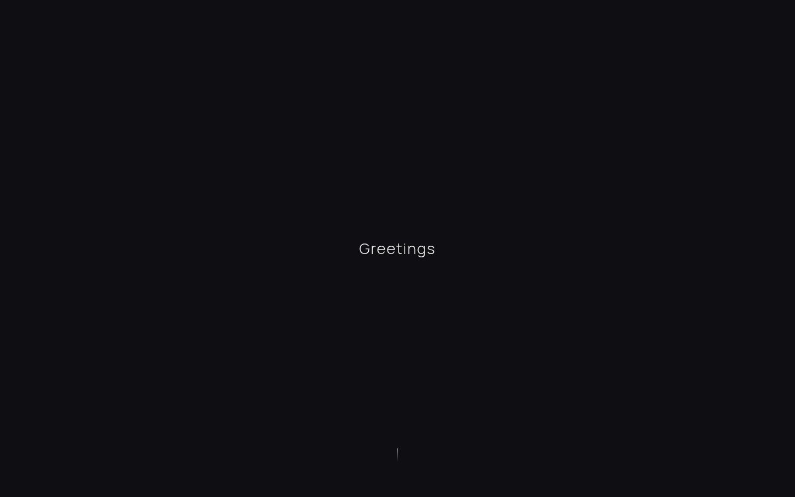
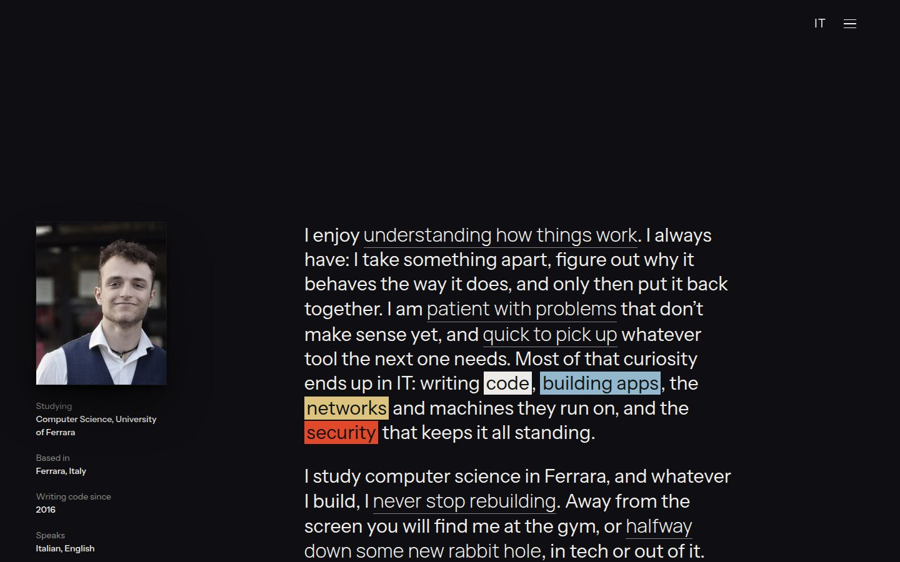
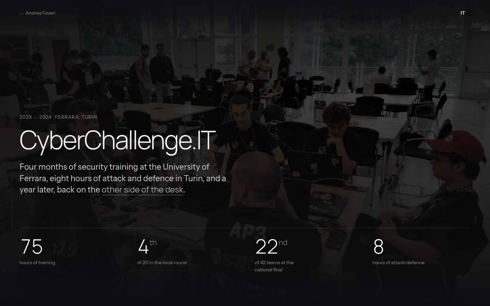
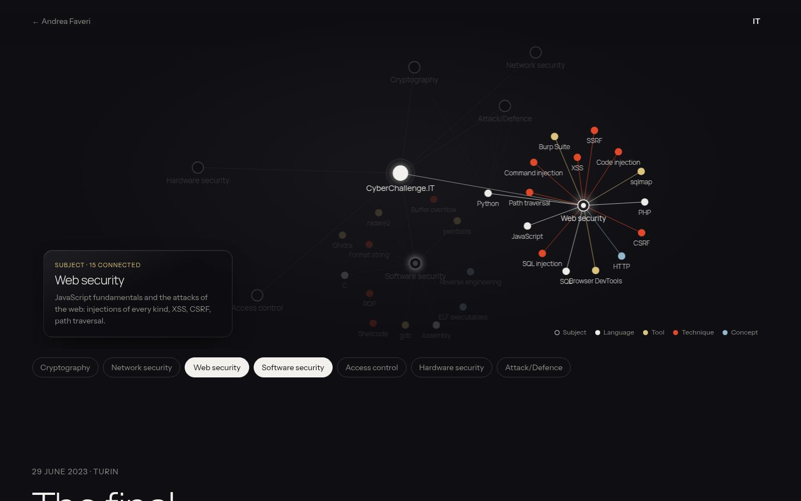
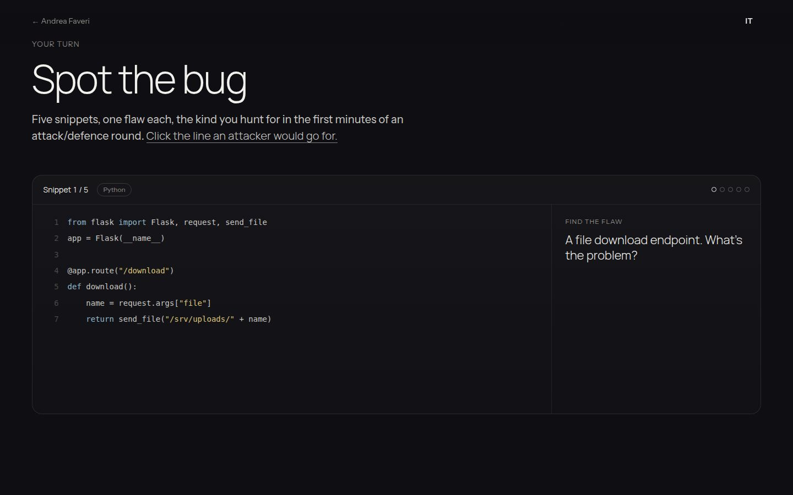

<p align="center">
  
</p>

<h1 align="center">rxsas.it</h1>

<p align="center">
  The personal site of <b>Andrea Faveri</b>, computer science student in Ferrara.<br>
  Hand-written HTML, CSS and JavaScript. No frameworks, no build step.
</p>

<p align="center">
  <a href="https://rxsas.it"><b>Visit the site →</b></a>
</p>

<p align="center">
  
  
</p>

---

## What’s inside

### Home page

| Section | What it does |
|---|---|
| **Greetings** | A dark opening screen. The word decrypts out of hex noise and cycles through 12 languages. |
| **About** | Portrait, a few facts and a short text where colours mark *what* I work with and underlines mark *who* I am. Links to the things I did. |
| **The workbench** | Every tool I actually use, as coloured book spines in four groups: languages, building apps, security, infrastructure. |
| **The road so far** | A timeline. Hovering a row slides its photo in behind it. |
| **Keep track of me** | Live from GitHub: pinned repos, the contribution grid and the latest pushes, plus a Follow button. |
| **Footer** | Email and socials. |

### CyberChallenge.IT page

<p align="center">
  
  
</p>

| Section | What it does |
|---|---|
| **Hero** | The title decrypts in over a photo of the national final; the key numbers count up. |
| **What I learned** | An Obsidian-style graph on a canvas, with its own small physics engine. Subjects open into the languages, tools, techniques and concepts behind them. Drag the dots around. |
| **The final** | An attack/defence round as a loop: find the flaw → write the patch → build the exploit. |
| **Spot the bug** | A minigame: five snippets, one flawed line each. Find it, then read why it’s dangerous and how to fix it. |
| **A year later, as a tutor** | Going back to the programme on the other side of the desk. |

<p align="center">
  
</p>

### Everywhere

- **English and Italian**, switchable at any time; the choice is remembered.
- **Works on phones and tablets**, checked at 360, 390, 768 and 1024 px.
- **Respects “reduce motion”**: animations calm down or stop.
- **Keyboard and screen-reader friendly**: interactive parts have button equivalents and text versions.

---

## How it’s built

- **Plain HTML, CSS and vanilla JavaScript.** No framework, no bundler, no dependencies to install.
- **Fonts:** Manrope Light for titles, Instrument Sans for text (Google Fonts).
- **Colours:** a near-black ground (`#0f0e12`) and four accents that always mean the same thing:
  bone for languages, sky for building apps, red for security, sand for infrastructure.
- **Live data** is fetched in the visitor’s browser and cached briefly:
  GitHub’s REST API for repos and followers,
  [github-contributions-api](https://github-contributions-api.jogruber.de) for the contribution grid,
  [pinned.berrysauce.dev](https://pinned.berrysauce.dev) for pinned repos.
- **Hosting:** GitHub Pages from `main`, served at [rxsas.it](https://rxsas.it) through the `CNAME` file.

## Structure

```
index.html            home page
cyberchallenge.html   CyberChallenge.IT page
cv.html               CV viewer + download
rxwoods.html          ┐
certificates.html     ┘ pages still under construction
css/style.css         all the styles
js/main.js            home page: menu, language, greeting, timeline, live GitHub data
js/i18n.js            Italian texts for the home page
js/cc.js              CyberChallenge page: language, title, numbers, entrances
js/cc-map.js          the "What I learned" graph
js/cc-final.js        the attack/defence round
js/cc-bug.js          the "Spot the bug" minigame
assets/               photos
docs/                 screenshots for this README (not published)
LOGBOOK.md            state, roadmap and changelog (not published)
```

## Run it locally

No install needed. Open `index.html` in a browser, or serve the folder so the live GitHub data
loads the same way it does online:

```sh
python3 -m http.server 8000
# then open http://localhost:8000
```

## Credits

Photos are my own, except: the Department of Mathematics and Computer Science building
(University of Ferrara, dmi.unife.it); Liceo Ariosto by Lungoleno (CC BY-SA 2.5); Apple IIe by
stiefkind (CC0); source code by Markus Spiske (CC0). Full credits are on the page that uses them.

The code and text are mine. If something here is useful to you, feel free to take inspiration,
but please don’t copy the site as a whole.

<p align="center"><sub>© 2026 Andrea Faveri · <a href="https://github.com/RexSAS">@RexSAS</a></sub></p>
